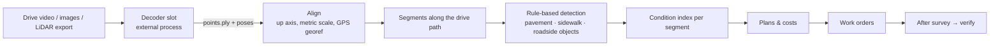

# iScale

(Formerly Civil Scan. The project folder, the Python package `civil` and the `civil` command keep their old names.)

An original, self-hosted street-inspection platform built from the workflow shown in
a city-infrastructure product video: **see it** (scan the street in 3D and inventory
every defect and asset), **plan it** (condition scores, repair plans and costs),
**fix it** (work orders) and **prove it** (re-scan after repairs and verify each fix).

**No machine-learning model runs inside this app.** Two external models plug in:

- a **pothole detector** (Roboflow hosted model `pothole-all-conditions-n6tqz/1`) scans
  the drive video, and every detection opens a window from 10 s before to 10 s after;
- **LingBot-Map** (your `lingbot-map.pt`) turns only those windows into 3D.

Everything after that is plain geometry and rules, and every finding says what was
measured and why it was flagged. See [docs/VIDEO_PIPELINE.md](docs/VIDEO_PIPELINE.md)
and [docs/LINGBOT_MAP.md](docs/LINGBOT_MAP.md).

## The pitch

**Find every pothole. Fix the right one first.** Road inspection for city engineering
teams, on a server your organisation runs.

- **Video in, measured potholes out.** Roboflow spots potholes in the drive video; only
  the 20 s around each find are rebuilt in 3D by LingBot-Map, so depth and size are measured.
- **A condition score for every 25 m**, repair plans with costs, work orders, budget limits.
- **Proof the fix happened:** drive again; each repair comes back verified, still present
  or not covered.
- **Fix first where traffic is heaviest:** severity x safety x traffic (OpenStreetMap road
  class; live Google congestion when the admin adds a key, used live and never stored).
- **Know what each repair needs:** every pothole shows its materials-only cost (cold mix,
  tack/prime coat, base; no labour) from its measured size and depth, using the DOH method
  (cut 30 cm past the damage). Tap it for the job card: photo, address, Navigate, bill of
  materials, best time to work and repair steps, laid out for phone and iPad.
- **One shared pothole map:** pin a pothole once, everyone on the server sees it; each
  colleague who confirms it pushes it up the list.
- **Crew chat that stays private:** 1:1 and group chats with the Signal Protocol; messages
  live on the devices, the server relays ciphertext and deletes it on delivery.
- **Civil Helper answers from your manuals:** RAG over the company's documents with sources;
  local Qwen by default, or any provider the admin connects.
- **Sign in with a username:** bound to the device by a key, no password; usernames and
  names are stored encrypted (AES-GCM, HMAC lookup ids).
- **Sign up as a company or on your own:** start a company (you are its admin) and invite
  people with a join code, join one with its code, or use an individual account that can
  become a company later. The host admin decides which sign-ups are allowed.
- **Your server, your data:** the admin picks internet (default), office network or this
  computer only. Admins get a Get-started checklist; everyone gets a first-run welcome.

The logic, formulas and figures behind all of this are in
[iScale-Logic-and-Figures.docx](iScale-Logic-and-Figures.docx)
(rebuild with `uv run python docs/build/figures.py && uv run --with python-docx python docs/build/make_docx.py`).

## Quick start

```bash
cd civil-scan
uv sync                                   # Python ≥ 3.11
ROBOFLOW_API_KEY=... uv run civil serve   # http://127.0.0.1:8765 (key only needed for video surveys)
```

Open <http://127.0.0.1:8765> and press **Load demo street**. Two synthetic drives of the
same L-shaped street are decoded and analysed in about 20 seconds: a baseline drive,
and an after-repairs drive in which some of the planted defects were fixed.

Then:

1. **Map**: a one-sentence summary, a straight-line diagram of the route (condition by
   chainage, defect ticks), and the map with segments coloured by condition.
2. **3D**: the point cloud with a box on every finding; *Tag an issue* to add one by hand.
3. **Inventory**: filter, sort and export (CSV, GeoJSON); select defects → work order.
4. **Repairs**: fix each defect or treat whole segments, optionally within a budget.
5. Work order → *Schedule* → *Mark completed* → **Verification**: compare with the after drive.
6. **Video**: detections along the drive, their frames and top-down views, and the 3D clips.
7. **Questions panel**: "where are the stop signs?", "which 3 segments are worst?",
   "plan repairs with a budget of 2k". It uses keyword rules, so the same question
   always gets the same answer.

Deep links: `/#map`, `/#scan`, `/#inventory`, `/#plan`, `/#verify`, `/#video`.

## How it works



| Stage | Module | What it does |
|---|---|---|
| Video | `civil/video/` | Detector sampling, ±10 s windows, clip frames, bird's-eye perspective transform, job runner |
| Decode | `civil/decoders/` | `pothole_video` (video job), `lingbot_clip` (one window through LingBot-Map), `demo` (synthetic street), `ply_import` (any decoded cloud), `external` (any configured command) |
| Align | `civil/align.py` | Up axis from metadata or the ground plane; scale and map position from a GPS track (Umeyama Sim(3)) or camera height; ground at z = 0 |
| Segment | `civil/analysis/segments.py` | 25 m road segments along the drive path; station and offset for every point |
| Detect | `civil/analysis/detect.py` | Road surface grown from the vehicle path up to the curbs; robust crown-aware surface fit; potholes, depressions, sunken covers, heaves, rough patches, sidewalk trip hazards; poles, streetlights, signs (type by plate colour), trees, hydrants |
| Score | `civil/analysis/condition.py` | PCI-like 0–100 index from severity and affected area (simplified deduct model, not certified ASTM D6433) |
| Plan | `civil/planning.py` | Spot repairs per finding and treatments per segment, priced from `config/unit_costs.json`, greedy within a budget |
| Verify | `civil/verify.py` | For each old defect: is the location covered, is it still detected, and how high is the surface now compared with its surroundings |
| Ask | `civil/chat.py` | Deterministic intent rules over the inventory, which return the ids to highlight |

### What geometry can and cannot find

Found by rules: potholes, depressions, sunken or raised covers, heaves, rough
patches (flagged as *possible* cracking, to confirm on site), sidewalk trip hazards,
streetlights, utility poles, signs (stop, warning, regulatory or guide, from the plate
colour), trees and hydrants.

Not separable by geometry alone: crack *types*, faded markings, covers that sit flush
with the road, graffiti and similar. The catalog (`civil/catalog.py`, 57 types) lists
how each type can be found. The rest come from **manual tags** in the 3D view or from
**labels supplied by a decoder** (`label` property in the PLY + `labels.json` that maps
label ids to catalog codes).

On the demo the rules recover every planted defect and asset except the flush cover,
which is undetectable by design. Real scans will need the thresholds in
`config/analysis.json` tuned to your sensor's noise.

## Inputs

| File | Format |
|---|---|
| Point cloud | PLY, ASCII or binary; `x y z`, optional `red green blue`, optional `label` |
| Poses | `poses.json` (`{"poses": [4×4…], "times": […]}`), TUM (`t tx ty tz qx qy qz qw`) or KITTI (12 values); camera-to-world |
| GPS | `gps.csv` with `t`, `lat` and `lon` columns |
| Labels | `labels.json`, e.g. `{"3": "sign_stop", "7": "pothole"}` |

Poses are required (they define the road segments). If the decoder isn't metric,
upload a GPS track or set the camera height in *Scale and placement*.

## Configuration

- `config/video.json`: detector, window length, clip frame rate, LingBot paths and GPU settings, camera calibration.
- `config/decoders.json`: other external decoders (command, outputs, metadata). Disabled until you set paths.
- `config/materials.json`: materials-only pothole estimate: method thresholds, DOH rates (tack 0.30 L/m², prime 1.0 L/m², cold mix 1,944 kg/m³, 30 cm cut margin) and default THB prices with their sources (Nov 2026). Admins override prices in Settings, Material prices. Crushed-rock base has no default price.
- `config/repair_timing.json`: suggested repair window per road class (a rule of thumb, editable).
- `config/unit_costs.json`: **placeholder** unit rates and segment treatments. Replace them with your own contract rates; every plan says so.
- `config/analysis.json` (optional): overrides for detection thresholds (see `civil/config.py` for the keys).
- Environment: `CIVIL_DATA_DIR`, `CIVIL_CONFIG_DIR`, `CIVIL_MAX_UPLOAD_MB` (default 4096), `CIVIL_FFMPEG`.

## API (selection)

`GET /api/meta` · `POST /api/projects` · `POST /api/demo` ·
`POST /api/projects/{pid}/surveys` (multipart: name, decoder, params, files) ·
`GET …/surveys/{sid}/analysis` · `GET …/surveys/{sid}/points.bin` ·
`POST|PATCH …/surveys/{sid}/findings` · `GET …/surveys/{sid}/plan?mode=spot|segment&budget=` ·
`GET …/surveys/{sid}/export.csv|geojson` · `POST|PATCH /api/projects/{pid}/workorders` ·
`POST /api/projects/{pid}/verify` · `POST /api/projects/{pid}/chat`.
Interactive docs: <http://127.0.0.1:8765/docs>.

## Layout

```
civil/            backend (FastAPI app, pipeline, analysis, decoders)
adapters/         lingbot_map.py: LingBot-Map runner and NPZ → PLY converter
config/           decoders.json, unit_costs.json
static/           UI (index.html, app.js, map.js, viewer.js, styles.css, vendor/)
tests/            pytest: units + end-to-end through the API
docs/             LingBot-Map guide and research report
data/             projects and surveys (created at runtime)
```

## Development

```bash
uv sync --extra dev
uv run pytest -q
uv run civil decoders      # which decoders are available
uv run civil demo          # build the demo project without the server
uv run civil calibrate VIDEO --t 12 --src ... --save   # road-plane calibration for the bird's-eye view
```

The server binds to 127.0.0.1 and has no login. Keep it that way, or put it behind
an authenticating reverse proxy before exposing it on a network.

## Third-party

three.js (MIT), MapLibre GL JS (BSD-3) and Public Sans (OFL) are vendored in
`static/vendor/` with their licences. Map tiles © OpenStreetMap contributors (online only; without WebGL the app
falls back to a plain SVG map with no basemap). LingBot-Map and the Roboflow model are
not included; the detector runs on Roboflow's servers (CC BY 4.0 dataset, see its page).

## Accounts, chat and data at rest

- The first person to open a new server sets up the company and becomes its admin; admins
  add engineers by username. Sign-in is the username plus a device key (no password).
- `data/secrets/db.key` (created on first start, mode 0600) encrypts usernames, names and
  group names. **Back it up**: without it the accounts can't be read. For stronger
  protection set `CIVIL_DB_KEY` (32 bytes, base64) outside the data folder instead.
  Databases from earlier versions are migrated and vacuumed on first start.
- Group chats: company admins create them (Messages, New group). Each message is encrypted
  per member on the sender's device; the server checks the roster and relays ciphertext.
- The bundled Signal library (`static/vendor/signal`) is GPL-3.0: keep the app inside your
  organisation, or release it under GPL-3.0, or swap the library before distributing it.

## Location (opt-in)

Each person decides whether iScale may use their device's location. After sign-in, iScale shows the agreement in
`config/location_agreement.md` once, with Accept and Decline. The answer is stored with the agreement's version
in `consent_log`. **Settings, Location** has the on/off switch, the agreement, **Delete my GPS tracks**, and, for
the host company's admin, the privacy contact shown in the agreement. To ask everyone again, change the
`version:` line.

When location is on, and only while iScale is on screen:
- **My location** shows a "you are here" dot with its accuracy. It stays on the device.
- **Pin where I am** waits for a GPS position within 10 m. The pin is saved with `source=device` and `accuracy_m`.
- **Record a drive** records the camera and a GPS track. The upload goes to the pothole-video pipeline. The track
  becomes `gps.csv`, which gives LingBot-Map surveys their real scale and position. Positions less accurate than
  30 m are dropped. Browser recordings are first converted to 30 fps MP4 (`civil/video/normalize.py`).
- **Share location** in chat sends a one-off position.

The server refuses GPS pins and drive tracks from people whose location is off (HTTP 403). Browsers allow
location and the camera only on HTTPS or on localhost.
