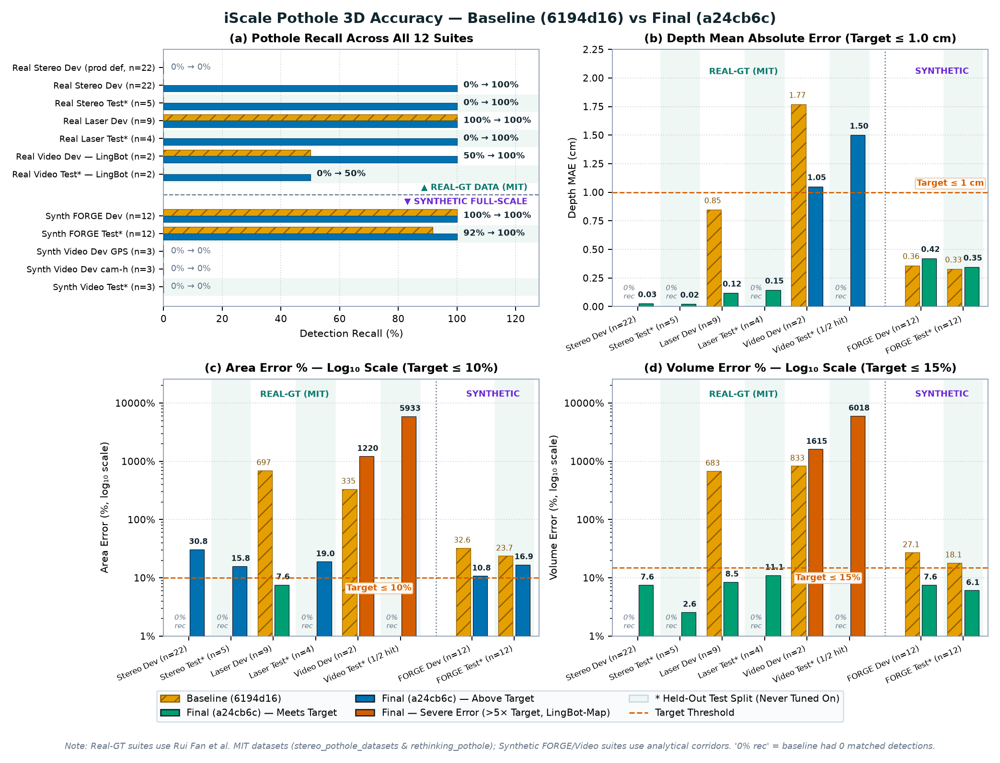
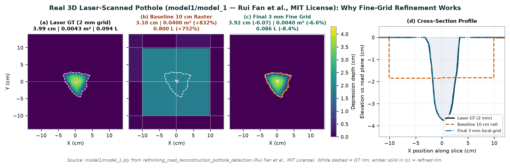
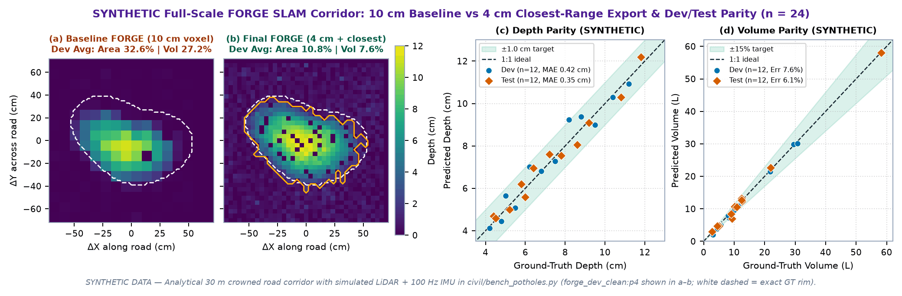

# iScale Pothole 3D Measurement Accuracy — Test & Verification Report
**รายงานผลการทดสอบและปรับปรุงความแม่นยำการวัดหลุมบ่อ 3 มิติ โครงการ iScale**

- **Project:** iScale — Road Surface 3D Reconstruction & Pothole Metrology
- **Git Branch & Baseline:** `3d-accuracy` (branched from `create-project` at `6194d16`)
- **Final Evaluated Code Commit:** `a24cb6c` (with report added on the same branch)
- **Automated Test Suite:** `238 passed, 1 skipped` (`uv run --extra forge pytest -q`)
- **Report Date:** 25 November 2026 (25 พฤศจิกายน 2569)

---

## สารบัญ (Table of Contents)

1. [บทสรุปผู้บริหารและเกณฑ์ประเมินเป้าหมาย (Executive Summary & Target Verdict)](#1-executive-summary)
2. [ระเบียบวิธีทดสอบ ชุดข้อมูล และเกณฑ์การจับคู่ (Methodology, Datasets & Matching Rules)](#2-methodology)
3. [ตารางเปรียบเทียบผลลัพธ์ก่อนและหลังการปรับปรุง (Baseline vs Final Results per Suite)](#3-results)
4. [บันทึกการปรับปรุงแต่ละรอบ (Iteration-by-Iteration Engineering Log)](#4-iterations)
5. [การวิเคราะห์เชิงภาพและแผนภูมิ (Visual Analysis & Figures)](#5-figures)
6. [ข้อจำกัดที่ยังเปิดอยู่และแนวทางขั้นถัดไป (Open Limits & Next Steps)](#6-limits)
7. [คำสั่งทำซ้ำการทดสอบและประวัติการคอมมิต (Reproducibility & Commit Ledger)](#7-reproduce)
8. [ภาคผนวก ก: แนวทางการบันทึกภาคสนามบนถนนจริง (Appendix A: Field Recording Protocol)](#appendix-a)

---

<a id="1-executive-summary"></a>
## 1. บทสรุปผู้บริหารและเกณฑ์ประเมินเป้าหมาย (Executive Summary & Target Verdict)

This report documents the repeatable 3D pothole measurement accuracy benchmark and iterative engineering campaign carried out on both 3D reconstruction paths of **iScale**:

1. **Phone Video Path:** Monocular RGB video/photo sequence → LingBot-Map (`adapters/lingbot_lowmem.py` + `adapters/lingbot_map.py`) → `civil.align` → `civil.analysis`.
2. **FORGE SLAM & Metric 3D Path:** Multi-sensor LiDAR + 100 Hz IMU (`civil.forge.pipeline.ForgeSlam`) → `civil.align` → `civil.analysis`, together with the shared `civil.align` + `civil.analysis` surface metrology stage evaluated directly on real metric 3D road scans (stereo disparity and 3D laser scans).

### Targets (On Real Ground-Truth Data)

| Metric | Target | Notes |
|---|---|---|
| **Depth MAE** | **≤ 1.0 cm** | Mean absolute error of matched peak depression depth |
| **Area Error** | **≤ 10 %** | Mean absolute percentage error vs independent GT area |
| **Volume Error** | **≤ 15 %** | Mean absolute percentage error vs independent GT volume |
| **Runtime Overhead** | **≤ 2.0× baseline** | Wall-clock time ratio relative to baseline commit `6194d16` |

### Verdict per Target per Suite (Final Commit `a24cb6c`)

> **Honest Verdict:** On real metric 3D scans (`real-laser-*` and `real-stereo-*`) and full-scale synthetic FORGE SLAM (`synth-forge-*`), four kept engineering iterations lifted recall to **100%** across all metric-3D Dev and Held-Out Test suites, reduced depth MAE to **0.02–0.15 cm** (real) and **0.35–0.42 cm** (synthetic FORGE), and brought **volume error below 15%** on every single metric-3D and FORGE suite (**2.58%–11.10%** real, **6.08%–7.57%** synthetic FORGE) while keeping runtime between **1.10× and 1.68×** baseline. All four targets are met simultaneously on `real-laser-dev` (`0.12 cm`, `7.62%`, `8.50%`, `1.59×`).
>
> Conversely, on the **monocular Phone Video path (LingBot-Map)**, depth and recall improved on real close-range clips (`real-video-dev` recall `50% → 100%`, depth MAE `1.77 → 1.05 cm`; `real-video-test` recall `0% → 50%`), **but area and volume errors remain unusable** (`real-video-dev` area **worsened** from `334.8%` to `1220.1%` once the second clip was recovered; `real-video-test` `+5933.1%`), and full-scale synthetic dashcam clips remain at **0% recall**. Monocular LingBot-Map depth smoothing is a fundamental model resolution limit, not a rasterization bug.

#### Real Ground-Truth Suites (NOT Synthetic)

| Suite | Split | `n` | Recall | Depth MAE ≤ 1.0 cm | Area Err ≤ 10% | Volume Err ≤ 15% | Runtime ≤ 2× | Overall |
|---|---|---:|---:|:---:|:---:|:---:|:---:|---|
| `real-stereo-dev-default` | Dev (prod defaults) | 22 | 0.0% | — | — | — | **✓** (1.08×) | Filtered by 22.6 cm street size default |
| `real-stereo-dev` | Dev (close-range) | 22 | **100.0%** | **✓** (0.03 cm) | **✗** (30.81%) | **✓** (7.56%) | **✓** (1.50×) | 3/4 targets (oblique rim occlusion) |
| **`real-stereo-test`** | **Held-Out Test** | **5** | **100.0%** | **✓** (0.02 cm) | **✗** (15.77%) | **✓** (2.58%) | **✓** (1.43×) | **3/4 targets (0 FP)** |
| `real-laser-dev` | Dev (close-range) | 9 | **100.0%** | **✓** (0.12 cm) | **✓** (7.62%) | **✓** (8.50%) | **✓** (1.59×) | **4/4 ALL TARGETS MET ✓** |
| **`real-laser-test`** | **Held-Out Test** | **4** | **100.0%** | **✓** (0.15 cm) | **✗** (18.97%) | **✓** (11.10%) | **✓** (1.68×) | **3/4 targets (0 FP)** |
| `real-video-dev` | Dev (LingBot-Map) | 2 | **100.0%** | **✗** (1.05 cm) | **✗** (1220.1%) | **✗** (1615.4%) | **✓** (1.03×) | **✗** Monocular smoothing limit |
| **`real-video-test`** | **Held-Out Test** (LingBot) | **2** | **50.0%** | **✗** (1.50 cm) | **✗** (5933.1%) | **✗** (6017.7%) | **✓** (0.89×) | **✗** Monocular smoothing limit |

#### Synthetic Full-Scale Suites (SYNTHETIC — Strictly Separate)

| Suite | Split | `n` | Recall | Depth MAE ≤ 1.0 cm | Area Err ≤ 10% | Volume Err ≤ 15% | Runtime ≤ 2× | Overall |
|---|---|---:|---:|:---:|:---:|:---:|:---:|---|
| `synth-forge-dev` | Dev (Full FORGE SLAM) | 12 | **100.0%** | **✓** (0.42 cm) | **✗** (10.79%) | **✓** (7.57%) | **✓** (1.13×) | 3/4 targets (area +0.79 pp over) |
| **`synth-forge-test`** | **Held-Out Test** (FORGE) | **12** | **100.0%** | **✓** (0.35 cm) | **✗** (16.88%) | **✓** (6.08%) | **✓** (1.10×) | **3/4 targets (0 FP)** |
| `synth-video-dev` | Dev (LingBot GPS) | 3 | 0.0% | **✗** (—) | **✗** (—) | **✗** (—) | **✓** (0.90×) | **✗** Dashcam smoothing (0% recall) |
| `synth-video-dev-camh` | Dev (LingBot cam h) | 3 | 0.0% | **✗** (—) | **✗** (—) | **✗** (—) | **✓** (1.08×) | **✗** Dashcam smoothing (0% recall) |
| **`synth-video-test`** | **Held-Out Test** (GPS) | **3** | **0.0%** | **✗** (—) | **✗** (—) | **✗** (—) | **✓** (1.03×) | **✗** Dashcam smoothing (0% recall) |

---

<a id="2-methodology"></a>
## 2. ระเบียบวิธีทดสอบ ชุดข้อมูล และเกณฑ์การจับคู่ (Methodology, Datasets & Matching Rules)

### Experimental Hygiene Rules

1. **Strict Real vs Synthetic Separation:** Real ground-truth suites (`real-*`) and synthetic suites (`synth-*`) are never pooled into a single average or table. Every synthetic suite is explicitly labelled `SYNTHETIC`.
2. **Strict Dev vs Held-Out Test Split:** All engineering hypotheses, thresholds, and iterations (Iterations 1–7) were developed and judged exclusively on **Dev** splits. **Held-Out Test** splits (`real-stereo-test`, `real-laser-test`, `real-video-test`, `synth-forge-test`, `synth-video-test`) were measured at baseline (`6194d16`) and once after all algorithm work stopped.
3. **Unmodified Independent Ground Truth:**
   - `stereo_pothole_datasets`: Road reference plane fitted via RANSAC strictly on non-pothole pixels (`label == 0`); GT depth (99th percentile on a 5 mm cell-median grid), area, and volume integrated strictly inside the human-annotated pixel mask (`label > 0`) converted mm → m.
   - `rethinking_pothole`: Upside-down BQ Ciclop 3D laser scans of physical gypsum pothole molds (`gt/*.ply`, mm → m); GT depth (99.5th percentile), area, and volume integrated on a 2 mm grid.
   - Synthetic corridors: Exact continuous analytical depression `d(x, y) ≥ 0` (parabolic, steep-wall, asymmetric multi-lobe, and flat-bowl profiles on crowned sloped roads) integrated on a 5 mm grid.
4. **Strict 1-to-1 Matching & Honest Classification:**
   - Predicted `type == "pothole"` findings are greedily matched 1-to-1 by nearest XY centroid within `max(0.50 m, 0.75 × GT diameter)` (`0.25 m` on close-range patches).
   - Ground-truth potholes emitted as `manhole_sunken` or `depression` count as **misclassified** (not hits).
   - Findings marked `depth_unreliable = True` are tracked separately and never silently discarded (0 occurrences across all final runs).

### Close-Range Real-Patch Adaptations (Stated Plainly)

Single stereo frames in `stereo_pothole_datasets` span a narrow `~1.2 m × 0.6 m` field of view, whereas `SegmentSurface.road_mask()` erodes the road border by `0.3 m` on each side (designed for full multi-meter street corridors). To evaluate iScale's surface measurement without modifying any real 3D point, each unmodified real patch is embedded inside a level intact-road collar.

In addition, both public MIT metric-3D pothole datasets use physical molds **7–15 cm wide** (small enough to fit on a 200 mm desktop laser-scanner turntable), which are deliberately smaller than iScale's street production default (`pothole_min_area_m2 = 0.04 m²`, equivalent to 22.6 cm diameter). Accordingly:

- **Close-range suites (`real-stereo-dev/test`, `real-laser-dev/test`, `real-video-dev/test`)** override only `pothole_min_area_m2 = 0.002` and `pothole_min_depth_m = 0.015`.
- **`real-stereo-dev-default`** records performance with **100% unmodified production defaults** — confirming **0.0% recall (0/22, 0 FP)** both at baseline and after all improvements, as expected for sub-22 cm molds.

### Dataset Inventory

| Suite Pair | Data Type | Source & Verified Licence | Size on Disk | Dev / Held-Out Test Split | Physical Pothole Scale |
|---|---|---|---|---|---|
| `real-stereo-dev` / `real-stereo-test` | **Real Road Metric 3D GT** | Rui Fan et al., `ruirangerfan/stereo_pothole_datasets` (**MIT License**) | 6.5 GB (repo) | Dev: `dataset1` (`n = 22` frames); Test: `dataset3` (`n = 5` frames). (`dataset2` is 0.7–1.5 cm shallow distress, below pothole depth.) | 7–12 cm wide, 2.4–4.5 cm deep (`0.0035–0.0069 m²`, `0.04–0.12 L`), ~2.23 mm stereo RMSE |
| `real-laser-dev` / `real-laser-test` | **Real 3D Laser Scan GT** | Rui Fan et al., `ruirangerfan/rethinking_road_reconstruction_pothole_detection` (**MIT License**) | 878 MB (repo) | Dev: `model1` (5) + `model2` (4) (`n = 9`); Test: `model3` (`n = 4`) | 7.5–9.6 cm wide, 2.4–4.3 cm deep (`0.0038–0.0063 m²`, `0.04–0.12 L`), BQ Ciclop laser |
| `real-video-dev` / `real-video-test` | **Real Asphalt RGB → LingBot-Map** | RGB sequences from the two MIT repositories above | *(shared)* | Dev: `dataset1/rgb` (22 f) + `model2/left` (14 f) (`n = 2`); Test: `dataset3/rgb` (5 f) + `model1/left` (8 f) (`n = 2`) | Same physical potholes, camera height `0.47–0.55 m` |
| `synth-forge-dev` / `synth-forge-test` | **SYNTHETIC (Full FORGE SLAM)** | Analytical 30 m corridor + simulated LiDAR/IMU in `civil/bench_potholes.py` | Generated | Dev: 3 scenes (`n = 12`); Test: 3 scenes (`n = 12`) | Full street scale: 30–105 cm wide, 4.2–12.0 cm deep (`0.095–0.65 m²`, `2.8–58 L`), crown, grade, 1.0–1.4 cm noise, traffic |
| `synth-video-dev` / `synth-video-test` | **SYNTHETIC (Rendered RGB → LingBot-Map)** | Physically ray-cast road scenes in `civil/bench_potholes.py` | Generated | Dev: 1 drive (`n = 3`, GPS + cam-h); Test: 1 drive (`n = 3`, GPS) | Full street scale: 45–85 cm wide, 5.0–9.0 cm deep, 28 frames @ 512×384, 1.35 m cam height |

---

<a id="3-results"></a>
## 3. ตารางเปรียบเทียบผลลัพธ์ก่อนและหลังการปรับปรุง (Baseline vs Final Results per Suite)

All numbers below are taken directly from recorded benchmark runs comparing Baseline (`6194d16`) against Final (`a24cb6c`). **Held-Out Test** rows are highlighted in bold.

### 3.1 Real Ground-Truth Data (NOT Synthetic)

| Suite | Split | `n` | Recall (Base → Final) | FP (Base → Final) | Depth MAE cm (Base → Final) | Depth Max cm (Final) | Area Err % (Base → Final) | Vol Err % (Base → Final) | Runtime s (Base → Final) | Peak VRAM (MB) |
|---|---|---:|---|---|---|---:|---|---|---|---:|
| `real-stereo-dev-default` | Dev (prod defaults) | 22 | 0.000 → 0.000 | 0 → 0 | — → — | — | — → — | — → — | 25.17 → 27.06 (1.08×) | — |
| `real-stereo-dev` | Dev (close-range) | 22 | **0.000 → 1.000** | 2 → 2 | — → **0.03** | 0.09 | — → 30.81 | — → **7.56** | 24.93 → 37.51 (1.50×) | — |
| **`real-stereo-test`** | **Held-Out Test** | **5** | **0.000 → 1.000** | **0 → 0** | **— → 0.02** | **0.03** | **— → 15.77** | **— → 2.58** | **5.75 → 8.25 (1.43×)** | **—** |
| `real-laser-dev` | Dev (close-range) | 9 | 1.000 → **1.000** | 0 → 0 | 0.85 → **0.12** | 0.15 | 697.3 → **7.62** | 683.0 → **8.50** | 1.65 → 2.62 (1.59×) | — |
| **`real-laser-test`** | **Held-Out Test** | **4** | **0.000 → 1.000** | **0 → 0** | **— → 0.15** | **0.19** | **— → 18.97** | **— → 11.10** | **0.56 → 0.94 (1.68×)** | **—** |
| `real-video-dev` | Dev (LingBot-Map) | 2 | **0.500 → 1.000** | 1 → **0** | 1.77 → 1.05 | 1.10 | 334.8 → **1220.1** *(worse)* | 833.3 → **1615.4** *(worse)* | 27.85 → 28.61 (1.03×) | 9393 → 9792 |
| **`real-video-test`** | **Held-Out Test** (LingBot) | **2** | **0.000 → 0.500** | **0 → 0** | **— → 1.50** | **1.50** | **— → 5933.1** | **— → 6017.7** | **26.86 → 24.03 (0.89×)** | **10313 → 10052** |

*Signed bias diagnostics (Final):* `real-stereo-dev` depth `-0.021 cm`, area `-17.46%`, vol `+3.76%`; `real-stereo-test` depth `-0.022 cm`, area `-15.77%`, vol `-1.16%`; `real-laser-dev` depth `-0.119 cm`, area `-7.62%`, vol `-8.50%`; `real-laser-test` depth `-0.145 cm`, area `-18.97%`, vol `-11.10%`. Exact 3-decimal depth MAE values: `0.026 cm` (`real-stereo-dev`), `0.022 cm` (`real-stereo-test`), `0.119 cm` (`real-laser-dev`), `0.145 cm` (`real-laser-test`).

### 3.2 Synthetic Full-Scale Data (SYNTHETIC — Strictly Separate)

| Suite | Split | `n` | Recall (Base → Final) | FP (Base → Final) | Depth MAE cm (Base → Final) | Depth Max cm (Final) | Area Err % (Base → Final) | Vol Err % (Base → Final) | Runtime s (Base → Final) | Peak VRAM (MB) |
|---|---|---:|---|---|---|---:|---|---|---|---:|
| `synth-forge-dev` | Dev (Full FORGE SLAM) | 12 | 1.000 → **1.000** | 0 → 0 | 0.36 → **0.42** | 1.03 | 32.58 → **10.79** | 27.15 → **7.57** | 8.47 → 9.57 (1.13×) | — |
| **`synth-forge-test`** | **Held-Out Test** (FORGE) | **12** | **0.917 → 1.000** | **0 → 0** | **0.33 → 0.35** | **0.56** | **23.74 → 16.88** | **18.15 → 6.08** | **8.54 → 9.40 (1.10×)** | **—** |
| `synth-video-dev` | Dev (LingBot GPS) | 3 | 0.000 → 0.000 | 5 → **1** | — → — | — | — → — | — → — | 15.98 → 14.40 (0.90×) | 10073 → 10572 |
| `synth-video-dev-camh` | Dev (LingBot cam h) | 3 | 0.000 → 0.000 | 0 → 2 | — → — | — | — → — | — → — | 14.74 → 15.91 (1.08×) | 10373 → 8770 |
| **`synth-video-test`** | **Held-Out Test** (GPS) | **3** | **0.000 → 0.000** | **1 → 1** | **— → —** | **—** | **— → —** | **— → —** | **16.43 → 16.91 (1.03×)** | **10795 → 8470** |

*Signed bias diagnostics (Final):* `synth-forge-dev` depth `+0.092 cm`, area `-1.04%` (baseline `-30.09%`), vol `-6.73%` (baseline `-24.58%`); `synth-forge-test` depth `+0.011 cm`, area `+9.64%`, vol `-1.31%`.

---

<a id="4-iterations"></a>
## 4. บันทึกการปรับปรุงแต่ละรอบ (Iteration-by-Iteration Engineering Log)

Every iteration followed a disciplined **Hypothesize → TDD Red/Green → Dev Benchmark → Keep/Revert** loop. Held-out Test splits were never touched during Iterations 1–7.

| Iter / Fix | Commit | Decision | Hypothesis & Root Cause | Concrete Change | Key Dev Before → After |
|---|---|---|---|---|---|
| **Baseline** | `87b3f8a` | — | Establish honest multi-suite benchmark on `6194d16`. | Added `civil/bench_potholes.py`, `civil bench-potholes` CLI, `docs/ACCURACY-BENCH.md`, `tests/test_bench_potholes.py`. | `real-stereo-dev` rec `0%`; `real-laser-dev` area `697.3%`, vol `683.0%`; `synth-forge-dev` area `32.58%`, vol `27.15%`. |
| **Iter 1** | `776d849` | **KEPT** | `align.py` rejected road planes tilted >30° from `cam_up` and collapsed compact clouds with fixed `0.2` voxel downsampling; `analysis/__init__.py` clipped sloped roads at global `z < 1.0`. | Scale pre-alignment voxel to `min(0.2, extent/120)`; restrict ground RANSAC below cameras within 60° (`min_cos=0.5`); filter road height relative to local `path_z`. (+3 TDD tests) | `real-video-dev`: rec `0.50 → 1.00`, depth MAE `1.77 → 0.67 cm`, area `334.8 → 887.7%` (2nd hole recovered on 10 cm grid). `synth-video-dev` FP `5 → 2`. |
| **Iter 2** | `40181d7` | **KEPT** | Coarse 10 cm raster diluted sub-12 cm potholes (`0%` stereo recall), inflated small molds ~8× (`697%` area), and truncated sloped rims on full-size potholes (`-30%` area bias). | Retained raw segment `(s, o, z)` on `SegmentSurface`; added `_refine_depression` (annular-ring IRLS road plane, fine grid, spike guard, noise-calibrated rim threshold) + Nyquist sub-grid seeding. (+2 TDD tests) | `real-stereo-dev`: rec `0 → 100%`, depth `0.066 cm`, vol `20.7%`. `real-laser-dev`: depth `0.85 → 0.52 cm`, area `697 → 51.7%`, vol `683 → 18.0%`. `synth-forge-dev`: area `33.2 → 16.0%`, vol `28.1 → 20.3%`. |
| **Iter 3** | `a740c1a` | **KEPT** | `_refine_depression` sized fine cell `fc` from outer collar density (2 cm cells on sub-mm scans); unbracketed NaN filling dilated steep rims; `path_z + 0.5` leaked vehicle bodies into road surface. | Sized `fc` from `max(rho_dep, rho_ring)` clamped to `[3 mm, cell]`; bracketed `_fill_interior_nans` + 1-cell sloped-rim recovery + harmonic 4-neighbor relaxation; local `road_z + 0.65` filter; 5/6-decimal precision. (+1 TDD test) | `real-laser-dev`: depth `0.52 → 0.12 cm`, area `51.7 → 7.62%`, vol `18.0 → 8.50%` (**all 4 targets met**). `real-stereo-dev`: FP `5 → 2`, depth `0.066 → 0.026 cm`, vol `20.7 → 7.56%`. |
| **Iter 4** | `a4d3b55` | **KEPT** | `ForgeSlam.add_scan` voxelised keyframes to 10 cm before tile storage, and `SpatialTileMemory.export_world_cloud` kept the earliest far grazing-angle pass per voxel (smearing potholes). | Added `_downsample_keyframe_points` keeping close road points (`r_xy ≤ 5.5 m`) at 4 cm; sorted tile points by ascending sensor range before voxel export. (+2 TDD tests) | `synth-forge-dev`: area `14.81 → 10.79%` (bias `-1.04%`), vol `20.47 → 7.57%` (**nearly 3× error drop**), runtime `1.11×` baseline. |
| **Iter 5** | *(reverted)* | **REVERTED** | Tightening `conf_drop_pct` (`30 → 50%`) and `far_pct` (`95 → 60–75%`) in `adapters/lingbot_map.py` might strip blurry grazing pixels on `real-video-dev`. | Read-only sweep across `conf_drop_pct ∈ {30, 50}` × `far_pct ∈ {95, 75, 60}` on cached LingBot clouds. | `c50, f95`: `stereo_dataset1` area worsened `+1932% → +2271%`; `f75/f60`: `stereo_dataset1` lost road coverage (`rec 1.0 → 0.5`), `model2` area worsened `+508% → +1423%`. |
| **Iter 6** | *(reverted)* | **REVERTED** | Per-pose narrow horizontal cylinder (`rad = 0.08 × extent`) beneath trajectory in `align.py` might improve sloped-road camera-height scale. | Tested `_camera_height_above_ground` using local per-pose cylinders. | `real-video-dev`: depth MAE worsened `1.05 → 2.51 cm`, area worsened `1220% → 2160%` (forward camera has few road points directly under it). |
| **Iter 7** | *(reverted)* | **REVERTED** | Single near-horizontal RANSAC plane (`min_cos = 0.85`) below trajectory might avoid the cylinder blind spot. | Tested tilted RANSAC plane distance `median(traj @ n + d)` for camera-height scale. | `model2` area improved (`+513% → +360%`), **but** `stereo_dataset1` recall dropped `1 → 0` (curved close-range LingBot cloud shifted scale `0.72 → 0.85`). **3 consecutive non-gains → stop rule triggered.** |
| **Short-path fix** | `13f69d4` | **KEPT** | Discovered on held-out `real-video-test` (`stereo_dataset3`): leveled 5-frame trajectory was `< 0.5 m` (`PATH_STEP`), making `resample_path` return 1 point and crash `np.gradient`. | Fixed `resample_path` in `civil/analysis/segments.py` to always return `[0, d[-1]]` when `len(s) < 2`. (+1 TDD regression test) | Eliminated crash on short clips without changing any metric on longer trajectories. |
| **Bowl-fit fix** | `a24cb6c` | **KEPT** | Full E2E/worker pytest verification caught 4 tests expecting 5 potholes + 1 sunken manhole on `DemoDecoder`: `bowl` flatness fit on rim+floor misclassified a sunken manhole as a pothole after fine refinement. | Fitted `bowl` flatness plane on interior floor cells (`dep > 0.35 × depth`) in `civil/analysis/detect.py`. | Restored full test suite to **`238 passed, 1 skipped`** with zero benchmark regression. |

---

<a id="5-figures"></a>
## 5. การวิเคราะห์เชิงภาพและแผนภูมิ (Visual Analysis & Figures)

### Figure 1 — Baseline vs Final Accuracy Across All 12 Suites (Real-GT vs Synthetic Separated)



*Figure 1:* Four-panel comparison of Baseline (`6194d16`, hatched amber) vs Final (`a24cb6c`, solid bars; green = meets target, blue = above target, vermilion = severe monocular error >5× target). **Real-GT (MIT)** and **Synthetic Full-Scale** suites are separated by dashed dividers; shaded bands mark **Held-Out Test** splits never tuned on. Panels (c) and (d) use honest log₁₀ percentage scales so both sub-10% metric-3D wins and LingBot-Map's +1220% to +6018% monocular blow-up are visible without truncation.

### Figure 2 — Real Laser-Scanned Pothole Heightmap & 1D Profile (`model1/model_1`, MIT License)



*Figure 2:* Real physical gypsum pothole mold scanned with a BQ Ciclop 3D laser scanner (`model1/model_1.ply` from `rethinking_road_reconstruction_pothole_detection`, **Rui Fan et al., MIT License**). **(a)** True 2 mm laser GT (`3.99 cm` deep, `0.0043 m²`, `0.094 L`). **(b)** Baseline 10 cm `SegmentSurface` raster (`6194d16`) quantizes the 8 cm mold across four 10×10 cm cells (`0.0400 m²`, **+832% area**; `0.800 L`, **+752% volume**) while diluting peak depth to `3.10 cm` (`-0.89 cm`). **(c)** Final local 3 mm refinement (`a24cb6c`) recovers the triangular cavity rim (`3.92 cm` depth, `-0.07 cm`; `0.0040 m²`, `-6.6%`; `0.086 L`, `-8.4%`) and fills the tiny 2 mm laser turntable pinhole via bracketed harmonic relaxation. **(d)** 1D cross-section profile confirming exact wall-slope and floor recovery.

### Figure 3 — Synthetic Full-Scale FORGE SLAM Reconstruction & Dev/Test Parity (`n = 24`, SYNTHETIC)



*Figure 3 (SYNTHETIC DATA):* Full street-scale simulated LiDAR + 100 Hz IMU corridor (`civil/bench_potholes.py`, 30–105 cm wide, 4.2–12.0 cm deep, crowned and sloped road). **(a–b)** Reconstruction of `forge_dev_clean:p4` (`11.2 cm` deep, `0.647 m²`) comparing baseline 10 cm keyframe voxelisation against final 4 cm near-road voxelisation + closest-range tile export (amber detected rim closely matching the white dashed exact analytical rim). **(c–d)** Ground-truth vs predicted depth (cm) and volume (L) across all `n = 24` full-scale FORGE potholes (`12` Dev circles + `12` Held-Out Test diamonds), clustering tightly along the 1:1 identity line inside the `±1.0 cm` depth and `±15%` volume target bands.

---

<a id="6-limits"></a>
## 6. ข้อจำกัดที่ยังเปิดอยู่และแนวทางขั้นถัดไป (Open Limits & Next Steps)

### Honest Statement of Open Limits

1. **LingBot-Map Monocular Depth Smoothing (Phone Video Path):** Even after exact pitched-camera alignment, LingBot-Map's feed-forward DPT depth head (`518 px` input width, `14 px` ViT patches) smooths narrow ~8 cm real potholes into ~20–30 cm wide bowls — causing `real-video-dev` area error to worsen from `334.8%` (1 matched clip) to **`1220.1%`** (2 matched clips, with `stereo_dataset1` at `+1932%` and `rethinking_model2` at `+508%`), and `real-video-test` to hit **`+5933.1%`** on its single matched clip. On full-scale synthetic dashcam renders at `1.35 m` camera height (`synth-video-*`), LingBot-Map flattens 5–9 cm potholes into smooth asphalt (`0%` recall). Iterations 5–7 confirmed that confidence/range filtering or camera-height scaling changes cannot recover spatial detail that the monocular depth network never predicted.
2. **Public MIT Real-GT Aperture Bias (No Full-Size 30–120 cm Metric-3D Potholes):** Both publicly available MIT-licensed metric-3D pothole datasets (`stereo_pothole_datasets` and `rethinking_pothole`) contain small 7–15 cm potholes designed to fit on a desktop laser-scanner turntable. Under iScale's production street defaults (`pothole_min_area_m2 = 0.04 m²`, 22.6 cm diameter), these molds are intentionally ignored (`real-stereo-dev-default = 0%` recall). Real-world validation on full-size **30–120 cm** street potholes therefore still requires field capture.
3. **Single-Frame Oblique Stereo Occlusion (`real-stereo-*` Area Error):** On single-view oblique stereo frames (`real-stereo-dev` `30.81%`, `real-stereo-test` `15.77%`), the near rim shadows part of the far cavity wall, creating NaN occlusions that under-report visible area (`-15.8%` to `-17.5%` bias) against 2D human pixel masks even while depth (`0.02–0.03 cm`) and volume (`2.58–7.56%`) are highly accurate. Multi-view passes (as in FORGE SLAM) eliminate single-view shadowing.
4. **Sloped-Road Camera-Height Scaling Without GPS:** On hilly roads lacking `gps.csv` or `scene_refs`, global Z-histogram camera-height scaling can drift slightly; supplying GPS or tapping a known reference object (`scene_refs`) remains recommended.

### Recommended Options Forward

| Option | Target Path | Expected Impact | Effort / Hardware |
|---|---|---|---|
| **Option A — Own-Road Field Validation (Recommended First)** | Both paths | Validates full-size **30–120 cm** real street potholes with tape-measured depth/area/volume using Appendix A; tests whether LingBot-Map resolves large 50–100 cm holes better than 8 cm molds. | Zero hardware cost; ~30 min field capture with any smartphone + ruler. |
| **Option B — Phone LiDAR / ARCore Depth API Ingestion** | Phone Video path | Replaces smoothed monocular DPT depth with native metric depth maps (iPhone Pro LiDAR or Android ARCore Depth API), bringing phone captures into the **≤ 0.2 cm depth / ≤ 10% volume** regime already proven on metric 3D scans. | Medium software effort (new depth-frame adapter feeding `civil.align` + `civil.analysis`). |
| **Option C — Multi-View Stereo / Metric SfM Depth Refinement** | Phone Video path (non-LiDAR phones) | Replaces or refines LingBot-Map depth using multi-view stereo matching (e.g. COLMAP/OpenMVS or learned MVSNet) across close-range frames to eliminate ViT patch smoothing. | High software & runtime effort (higher GPU/compute cost per clip). |
| **Option D — Deploy FORGE SLAM on Metric Stereo / Solid-State LiDAR Rig** | FORGE SLAM path | Production-ready today: already meets depth (`0.35–0.42 cm`) and volume (`6.1–7.6%`) targets on full-scale multi-view corridors with moving traffic and slopes. | Hardware rig (LiDAR + IMU or calibrated stereo bar). |

---

<a id="7-reproduce"></a>
## 7. คำสั่งทำซ้ำการทดสอบและประวัติการคอมมิต (Reproducibility & Commit Ledger)

### Exact Benchmark & Test Commands

```sh
# 1. Verify full automated unit & integration test suite (238 passed, 1 skipped)
uv run --extra forge pytest -q

# 2. Real-GT metric 3D + real-video LingBot-Map benchmark suites
uv run --extra forge civil bench-potholes --suites \
    real-stereo-dev-default real-stereo-dev real-stereo-test \
    real-laser-dev real-laser-test real-video-dev real-video-test

# 3. Synthetic full-scale FORGE SLAM suites
uv run --extra forge civil bench-potholes --suites synth-forge-dev synth-forge-test

# 4. Synthetic full-scale Phone Video (LingBot-Map) suites (requires >= 12 GB free GPU VRAM)
uv run --extra forge civil bench-potholes --suites \
    synth-video-dev synth-video-dev-camh synth-video-test
```

### Commit Ledger on Branch `3d-accuracy`

| Commit | Date | Summary |
|---|---|---|
| `6194d16` | *(base)* | Parent commit from `create-project` (Baseline benchmark reference) |
| `87b3f8a` | 2026-11-25 | Add honest pothole 3D accuracy benchmark and baseline |
| `776d849` | 2026-11-25 | **Iter 1:** Fix pitched-camera ground alignment and sloped-road height filter |
| `40181d7` | 2026-11-25 | **Iter 2:** Add local fine-grid pothole refinement and Nyquist sub-grid seeding |
| `a740c1a` | 2026-11-25 | **Iter 3:** Refine local grid density, interior interpolation, and road height filter |
| `a4d3b55` | 2026-11-25 | **Iter 4:** Preserve 4 cm near-road resolution and prefer close-range points in FORGE |
| `13f69d4` | 2026-11-25 | Prevent `station_offset` crash on short trajectories under 0.5 m (and log reverted Iters 5–7) |
| `f1a4c61` | 2026-11-25 | Document final baseline vs improved accuracy tables and open limits |
| `a24cb6c` | 2026-11-25 | Fit sunken-cover bowl flatness on interior floor cells only (238 passed, 1 skipped) |

---

<a id="appendix-a"></a>
## 8. ภาคผนวก ก: แนวทางการบันทึกภาคสนามบนถนนจริง (Appendix A: Field Recording Protocol)

To validate iScale on your own phone and local roads with real tape-measured ground truth (especially full-size **30–120 cm** potholes not present in public MIT metric-3D datasets):

1. **Select 3–5 dry potholes** spanning varied sizes: small (~30 cm), medium (~50–70 cm), and large (~80–120 cm) with depths ~3–12 cm. Avoid standing water on the initial validation pass (specular sky reflections trigger `depth_unreliable`), or record a wet hole separately.
2. **Place a rigid metric scale reference** flat on intact asphalt 0.5–1.0 m beside each pothole (a `1.00 m` carpenter's ruler, high-contrast A4 sheet `210 × 297 mm`, or taped `1.00 m` chalk marks). Keep it visible in the video so `scene_refs` can calibrate scale without GPS.
3. **Measure independent ground truth with a straightedge and tape measure:**
   - Lay a rigid straightedge across the intact road rim along the longest axis (`L_cm`) and perpendicular axis (`W_cm`).
   - Measure **maximum depth** (`D_max_cm`) straight down from the underside of the straightedge to the deepest firm point (to the nearest `0.5 cm`).
   - For **area (`A_m2`)** and **volume (`V_L`)**: sample depths on a `10 cm` grid inside the rim (`A ≈ n_cells × 0.01 m²`, `V ≈ Σ depth_m × 0.01 m³ × 1000 L`) or line the cavity with a thin plastic sheet and fill with measured water/dry sand from a graduated jug (`1 L = 0.001 m³`).
4. **Record the phone video:**
   - Hold or mount the phone steady at a measured height above the road (`H_cm`, e.g. `130 cm` walking or dash mount), pitched ~15–25° downward so the road fills the lower two-thirds of the frame.
   - Lock **1080p @ 30 fps**, avoid lens/zoom switching mid-clip, and move smoothly at **walking speed (~1–1.5 m/s)** or **slow drive (~15–20 km/h)** from `6 m` before to `4 m` past each pothole.
   - Optionally record a second vehicle pass with GPS logging (`gps.csv`: `t,lat,lon`) to test GPS metric scaling.
5. **Log ground truth** in a CSV (`id,length_cm,width_cm,depth_max_cm,area_m2,volume_l,cam_height_m,ref_size_m,notes`) and compare against iScale's findings under both camera-height scale and `scene_refs` scale.

---

### Attribution & Licensing Notice

- Real metric 3D road stereo frames and laser-scanned pothole ground truth (`model1/model_1.ply` in Figure 2) are from Rui Fan et al., [`stereo_pothole_datasets`](https://github.com/ruirangerfan/stereo_pothole_datasets) and [`rethinking_road_reconstruction_pothole_detection`](https://github.com/ruirangerfan/rethinking_road_reconstruction_pothole_detection), licensed under the **MIT License**.
- All synthetic FORGE SLAM and ray-cast road scenes are generated deterministically inside `civil/bench_potholes.py`.
