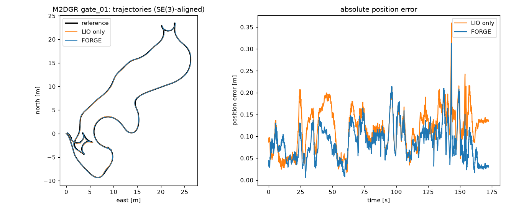
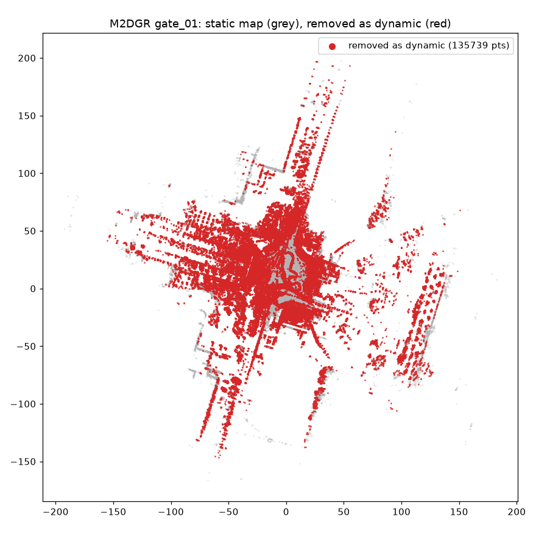

# FORGE SLAM — evaluation results

Status: real-data evaluation on **one** recorded sequence (M2DGR `gate_01`). The road-driving sequence with
radiometric thermal (STheReO Valley Afternoon) is **pending**: its Google Drive files could not be downloaded
(quota exceeded on every retry). Everything in the "Real data" section was produced by running the pipeline on the
recorded sensor streams; nothing there is simulated.

Reproduce:

```sh
uv run --extra forge civil forge eval-real \
    --m2dgr-bag gate_01.bag --m2dgr-gt GT_gate_01.txt --out <out-dir> --figures docs/figures
```

## Data

| Sequence | Source | Streams used | Reference | Licence |
|---|---|---|---|---|
| M2DGR `gate_01` (172.5 s, 127.5 m, closed loop) | rosbag, 16.4 GB | Velodyne VLP-32C (1722 scans), Handsfree IMU (24 545 samples), RealSense D435i colour (2490 frames), PLUG 617 thermal (4314 frames, 8-bit relative, **not radiometric**) | RTK GNSS-INS (`GT_gate_01.txt`) | MIT (SJTU-ViSYS) — figures below come from it |
| STheReO Valley Afternoon | Google Drive | — not obtained (Drive quota) | — | no licence stated: data and figures stay out of this repo |
| KAIST MS² | Google Form | — not used (needs the survey) | — | CC BY-NC-SA 3.0: data and derived images never go into this repo |

## Real data: M2DGR gate_01

Configuration: `keyframe_dist_m=1.0`, `voxel_size_m=0.1`, cameras sampled at 1 Hz (169 RGB + 169 thermal frames).

| Metric (gate_01) | LIO only | FORGE (loops + pose graph) |
|---|---|---|
| ATE RMSE (SE(3) Umeyama fit, no scale; 1722 scans) | 0.126 m | **0.095 m** (−25 %) |
| ATE median / max | 0.120 / 0.359 m | 0.086 / 0.313 m |
| RPE over 10 m segments (RMSE) | 0.129 m (1.29 %) | 0.126 m (1.26 %) |

The reference point is the GNSS antenna (lever arm from the M2DGR calibration).

| Loop closure and pose graph (gate_01) | Value |
|---|---|
| Accepted loop constraints | 32 |
| Correct (length matches the reference distance within 0.5 m) | 32 → precision 1.00 |
| Revisit keyframes (reference < 3 m to a keyframe ≥ 25 s and ≥ 15 m of path earlier) | 46 |
| Revisits closed by a correct loop | 32 → recall 0.70 |
| Candidates rejected by the Scan-Context threshold | 730 |
| Pose-graph error (GTSAM iSAM2, 198 poses, 230 factors) | 10.87 → 0.96 |

| Dynamic filter (gate_01) | Value |
|---|---|
| Points removed | 135 739 of 6 325 633 (2.15 %) |
| Height above local ground of removed points (sampled 1 in 10) | 72 % in 0.15–2.5 m (pedestrian/car band), 15.5 % below 0.15 m (road surface), 12.9 % above 2.5 m |
| Removed points ≥ 20 m from the whole path | 57 % (of these, 20 % lie above 2.5 m) |

No per-point labels exist for gate_01, so dynamic-removal precision and recall were **not measured**. The height
split bounds it: removals above 2.5 m (mostly far from the path) are almost certainly static structure, and the
road-surface share is about 21 k points (0.3 % of input). The 0.15–2.5 m share is consistent with pedestrians and
traffic (the long streaks along the streets in the figure), but that is unverified.

| Tile memory (gate_01, LiDAR + IMU only) | Uncapped | RAM cap 4 MiB |
|---|---|---|
| Peak tile RAM | 74.3 MB | 4.16 MB (cap 4.19 MB) |
| Evictions / reloads | 0 / 0 | 145 / 145 |
| SSD I/O time | 0 | 1.76 s |
| Map | 4 656 080 points | identical (every point within 1 µm) |

Two uncapped runs already differ by ~1e-13 m (loop closure and GTSAM are not bit-reproducible), so the check uses a
1 µm tolerance rather than bit equality.

| Runtime (gate_01, one CPU process) | Value |
|---|---|
| Per scan (deskew + ESKF update + local map), median / p95 | 36 ms / 103 ms (10 Hz LiDAR → 100 ms budget) |
| Per keyframe (dynamic filter, loop search, graph, tile write), median | 64 ms |
| LiDAR + IMU only, whole sequence incl. bag decoding | 88 s for 172.5 s of data |
| Full run incl. camera decoding, registration (19 s) and splats (26 s) | 143 s |
| Peak RSS | 1.46 GB |

| Camera registration (gate_01) | RGB (D435i) | Thermal (PLUG 617) |
|---|---|---|
| Median distance, projected LiDAR depth edges → image edges | **3.65 px** | **3.31 px** |
| Same with the extrinsic rotated by 2° | 5.95 px | 3.41 px |
| Random pixels → image edges (chance) | 9.35 px | 26.8 px |
| Best time offset tried (−0.1 … +0.1 s) | 0.0 s | −0.1 s (3.20 px; within noise) |

12 frames per camera, ~88 k (RGB) / ~163 k (thermal) edge points. RGB: the extrinsic and time sync are consistent,
and a 2° error would show. Thermal: LiDAR edges land on thermal edges far better than chance (3.3 px vs 26.8 px),
but a 2° extrinsic error cannot be told apart. Thermal edges are temperature boundaries, not always geometry. So
the thermal extrinsic is checked only coarsely, and no °C error can be measured on this sequence (non-radiometric
camera).

| Splats (gate_01, RGB) | Value |
|---|---|
| Splats / views | 150 000 point-anchored splats; 136 training, 33 held-out RGB views (every 5th) |
| Held-out pixel coverage | 42 % |
| Held-out PSNR, projected map colours (no fit) → after fit | 20.94 → 20.88 dB |
| Held-out SSIM (single-window, over covered pixels) → after fit | 0.822 → 0.821 |

The colour fit does not improve held-out views over the projected map colours. This is not full 3DGS: positions,
scales and opacities are fixed. The thermal splat channel was not evaluated (gate_01 thermal is not radiometric).
The SSIM is a global per-channel statistic, not the usual 11×11 windowed SSIM.





Figures: M2DGR dataset (SJTU-ViSYS, MIT licence), processed by FORGE.

### Against the design goals (gate_01 only)

| Goal | Target | gate_01 | Met |
|---|---|---|---|
| G1 LIO drift | < 1.5 % | 1.29 % (RPE 10 m) | ✓ |
| G2 dynamic removal | ≥ 85 % removed, < 2 % road loss | removal rate not measurable (no labels); road loss ≈ 0.3 % of input points | — |
| G3 loop precision | 100 % | 32 / 32 | ✓ |
| G3 ATE reduction on loops | ≥ 40 % | 25 % | — |
| G4 bounded RAM | cap respected, map unchanged | 4.16 / 4.19 MB, identical | ✓ |
| G5 thermal °C | radiometric registration | not testable on gate_01 | — |

One 127 m sequence is not a benchmark; the numbers say how this sequence went, nothing more general.

### Approximations in the scoring

* Loop correctness compares the constraint's translation length with the reference distance (the scorer uses
  reference positions only, not the INS orientation). A wrong loop of the right length would pass.
* The ATE reference point is the GNSS antenna; the lever arm comes from the M2DGR calibration file.
* Camera registration uses edges, not a calibration target; it shows consistency, not absolute accuracy.

## Synthetic sanity check (not a dataset evaluation)

Method: an M2DGR ground-truth path (positions only) places simulated keyframes; LiDAR scans are cut from a
synthetic street (road, walls) built around that path, and the "odometry" is the ground-truth path with injected
rotation/translation drift. The ESKF, the dynamic filter and the cameras are not used. It only checks that
Scan-Context + G-ICP finds revisits and that the GTSAM graph removes injected drift (`civil forge eval`).

| Path (simulated scans) | Length | ATE injected drift → after graph | Loops accepted / correct | Simulated revisits | Recall |
|---|---|---|---|---|---|
| gate_01 | 139 m | 0.303 → 0.029 m | 22 / 22 | 11 | 1.00 |
| gate_02 | 290 m | 0.940 → 0.373 m | 1 / 1 | 1 | 1.00 |
| street_03 | 424 m | 0.947 → 0.066 m | 28 / 28 | 22 | 0.95 |
| street_04 | 840 m | 7.27 → 7.27 m | 0 / 0 | 4 | 0.00 |

On street_04 no revisit was found, so the drift stays. Precision is undefined when nothing is accepted.

## Not done

* Road-driving sequence with radiometric thermal (STheReO or KAIST MS²): not downloaded. Thermal °C accuracy,
  thermal splats and road-scale ATE are therefore untested on real data.
* Dynamic-removal precision/recall: needs labelled moving objects.
* Only gate_01 was run; M2DGR street sequences with loops (e.g. street_03) were not downloaded.
