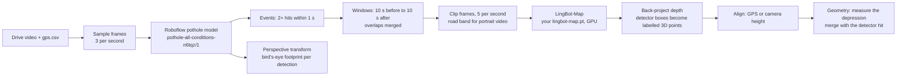

# Drive video → pothole detection → LingBot-Map 3D



Only the windows around detections are rebuilt in 3D, so an hour of driving with a
handful of potholes costs a handful of 20-second LingBot runs.

## Running it

1. Start the server with your Roboflow key in the environment:

   ```bash
   ROBOFLOW_API_KEY=... uv run civil serve
   ```

2. **Add survey** → source *Drive video → pothole detector → LingBot 3D clips* →
   upload the video and, if you have it, `gps.csv` (`t,lat,lon`, `t` in seconds from
   the first video frame). Without GPS, set the camera height above the road.
3. The **Video** page shows the timeline (red ticks are detections, blue bands are
   the 3D windows), each detection with its frame and top-down view, and one row per
   clip. A finished clip opens in Map and 3D like any other survey. A clip that
   failed, for example because the GPU was busy, has **Try again**.
4. Without GPS the clip's size is a camera-height guess. **Fix scale with scene objects**
   on the clip row taps objects of known size (lane width, kerb height, a tape-measured
   distance…) in the clip's frames, rescales the clip and re-runs the analysis, so depth,
   area and cost become measurements with a ± range. Method and error model:
   [SCENE_SCALE.md](SCENE_SCALE.md).

## Detector (Roboflow, hosted)

`config/video.json → detector`. It calls Roboflow's serverless API with your snippet
(`InferenceHTTPClient(...).configure(InferenceConfiguration(api_key_transport="header"))`,
`client.infer(image, model_id="pothole-all-conditions-n6tqz/1")`).

- Sampled frames are **sent to Roboflow's servers** and use your account's credits:
  about 3 calls per second of video at the default `sample_fps`.
- Model facts from its Universe page (2026-11-14): YOLOv11n, one class "Potholes",
  mAP@50 70.1%, precision 72.8%, recall 64.2%, trained on dataset version 1. The
  32,209-image version 2 has no published model; training on it locally would
  need the dataset download (Roboflow API key) and a GPU.
- `confidence` 0.45, `min_hits` 2 within `hit_gap_s` 1.0: a single-frame flicker
  doesn't open a window. In the smoke test, compressed video frames of a pothole
  photo scored 0.47; the same photo as a still scored 0.67. Lower `confidence`
  slightly if you see misses.

## LingBot-Map on a 16 GB GPU

`config/video.json → lingbot`. Tested on this machine (RTX 5080, 16 GB, desktop
using ~2.6 GB) with `lingbot-map.pt` at commit `8fdf984`:

| Setting | Why |
|---|---|
| `bf16_weights: true` | Runs `batch_demo.py` through `adapters/lingbot_lowmem.py`: transformer backbone in bfloat16 (it already computes in bfloat16), depth head in chunks of 2 frames. Same output files. |
| `--num_scale_frames 4 --kv_cache_scale_frames 4 --kv_cache_sliding_window 32 --keyframe_interval 2 --max_frame_num 256` | Smaller cache; the defaults need ~13.3 GB. |
| `--use_sdpa` | FlashInfer compiles kernels for the smaller cache at runtime and needs `nvcc`, which isn't installed. |
| `frames.fps: 5` | ~100 frames per 20 s clip. |
| `env.LD_PRELOAD` | The conda env's matplotlib needs the system FreeType on NixOS. Update the path if the Nix store changes: `ls -d /nix/store/*-freetype-*/lib/libfreetype.so.6`. |

Result: 109 frames in 22 s. With these settings the default Ollama model must not
be loaded at the same time (it holds ~12 GB). On a 24 GB+ GPU, drop the extra
arguments and `bf16_weights` for the authors' defaults.

The converter checks which way LingBot's saved `extrinsic` points (it differs
between LingBot commits) by testing which direction makes neighbouring depth maps
overlap, and records the choice in `work/decoded/lingbot_convert.json`.

## Perspective transform (bird's-eye view)

`civil/video/perspective.py`, `config/video.json → perspective`. Four points on the
road in the video frame (top-left, bottom-left, bottom-right, top-right) are matched
to a rectangle of known size in metres with `cv2.getPerspectiveTransform`, and frames
are warped with `cv2.warpPerspective`. Each detection box then gets a width, area and
distance ahead in metres, plus a top-down evidence image.

The defaults are a guess. Calibrate once per camera mount:

```bash
uv run civil calibrate drive.mp4 --t 12 \
  --src 0.43,0.60 0.08,0.92 0.92,0.92 0.57,0.60 --width-m 3.5 --length-m 12 --near-m 4
# check calibration/calibrate_overlay.jpg and calibrate_bev.jpg; lane lines must come out
# straight and parallel. Then add --save.
```

Until calibrated, the app shows no 2D size estimates; boxes that fall outside the
calibrated road area (above the horizon, beside the road) are never sized.

## What the smoke test showed

A 30 s phone video (indoor room walk-through) with a real road-pothole photo spliced
in at 12–14 s: six detections at 12.0–13.7 s, one window 2.0–23.7 s, 109 frames,
LingBot reconstruction of the room with 36,660 points labelled from the detector boxes.
The detector hit is reported as "detected in the video; no depression measurable in
3D" because a spliced still has no real depth. Two shallow "potholes" on the glossy
floor are depth noise on reflective tiles. A real drive is needed to judge accuracy.

## Field test (14 Nov 2026)

Rangoon Road news clip (YouTube R2Vr3R_Dpj0, 40 s, 640x360, filmed on foot, no GPS): detector
boxes in 112 of 121 sampled frames, one 0-40 s clip, LingBot 201 frames in 23.6 s. The
reconstruction bent about +-25 cm along the 22 m walk, which a single surface fit per 25 m
segment read as huge potholes. Video clips now fit the road in 8 m windows
(`config/video.json -> analysis.surface_window_m`). Result: 10 potholes (8 confirmed by the
detector), 0.3-2.3 m across. Depth through standing water is not reliable. Details and
figures: section 12 of `iScale-Logic-and-Figures.docx`
(`uv run python docs/build/field_test.py <project> <video survey> <clip survey> <video.mp4>`).


### Placing a survey without GPS on its real street (15 Nov 2026)

The Rangoon Road clip was moved from the default Bangkok origin onto Rangoon Road, Leonardsville,
Ladysmith (OpenStreetMap way 854179657), starting at the Nagpur Road junction and heading 304°.
`docs/build/replace_field_test.py <project> <clip survey>` turns the *finished* survey (3D points,
camera path, findings) as one rigid piece and recomputes latitude/longitude, so no measurement
changes. Do not re-run the analysis at the new angle instead: the analysis grid follows the map
axes, and re-analysing at 304° changed the largest pothole from 2.27 m to 3.06 m across.
`docs/build/field_map.py <project> <clip survey>` draws the pothole map (docx figure 13) on
OpenStreetMap tiles, cached in `docs/build/fig/.tiles`.
